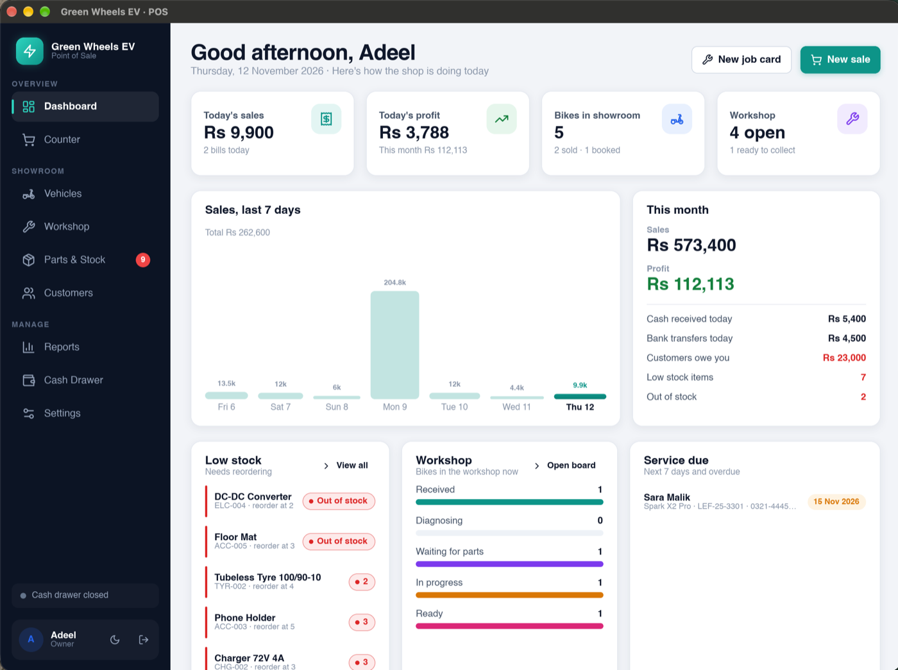
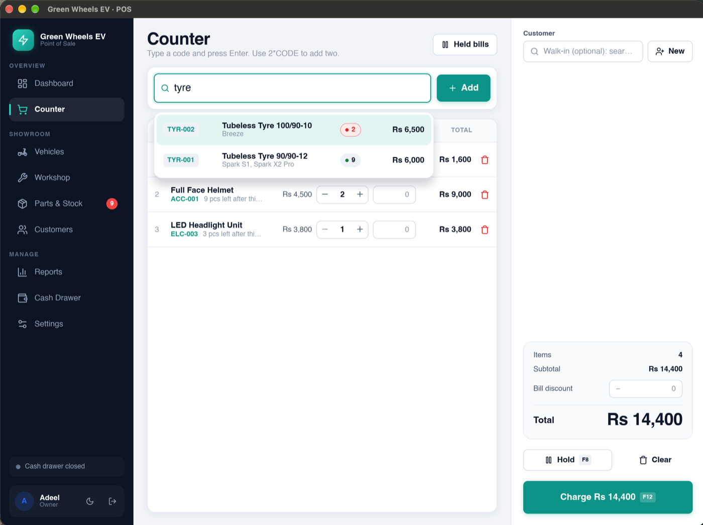
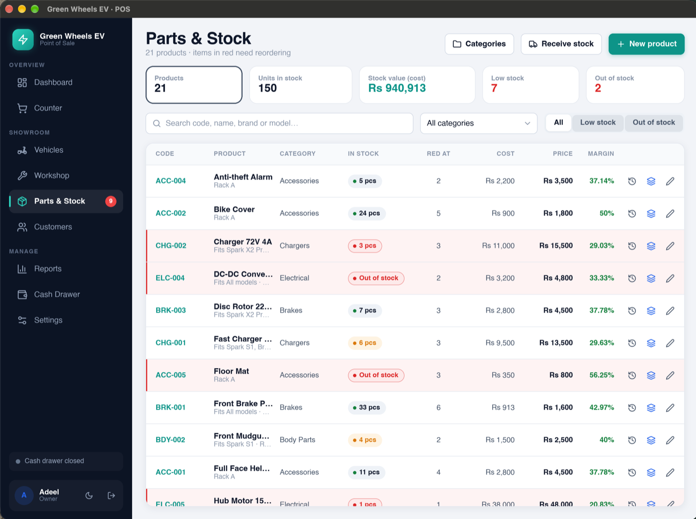
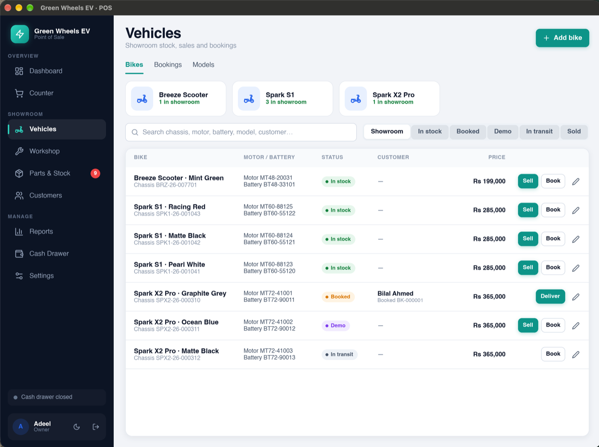
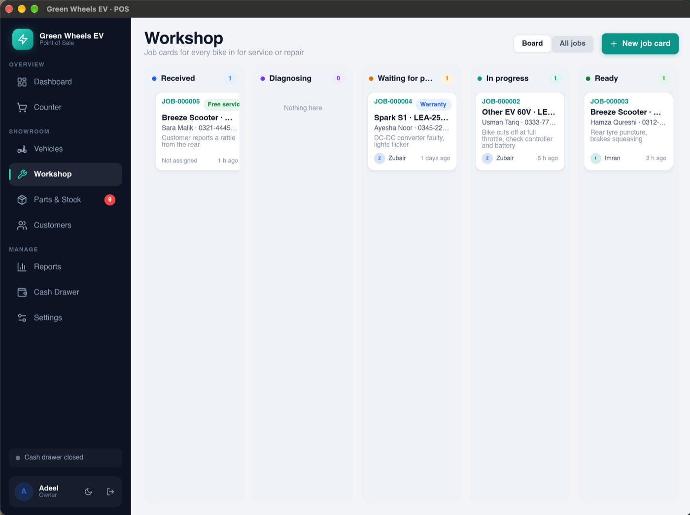
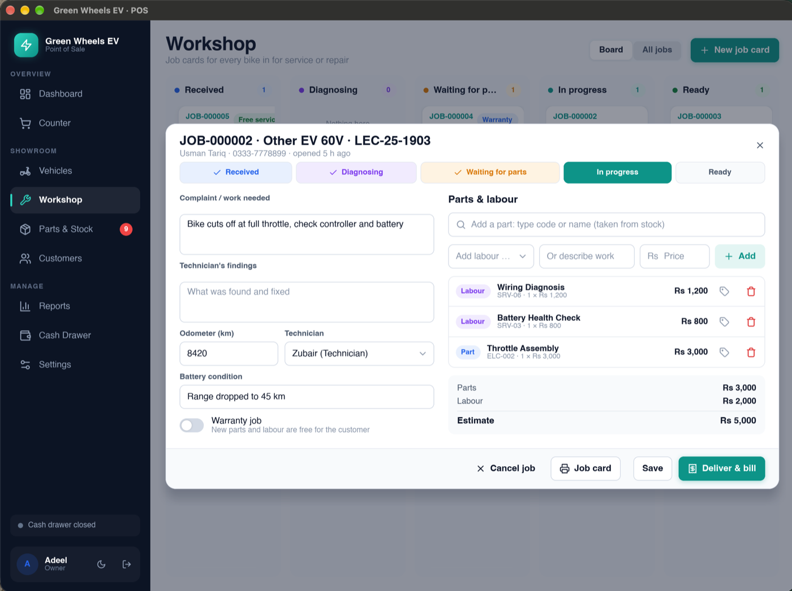
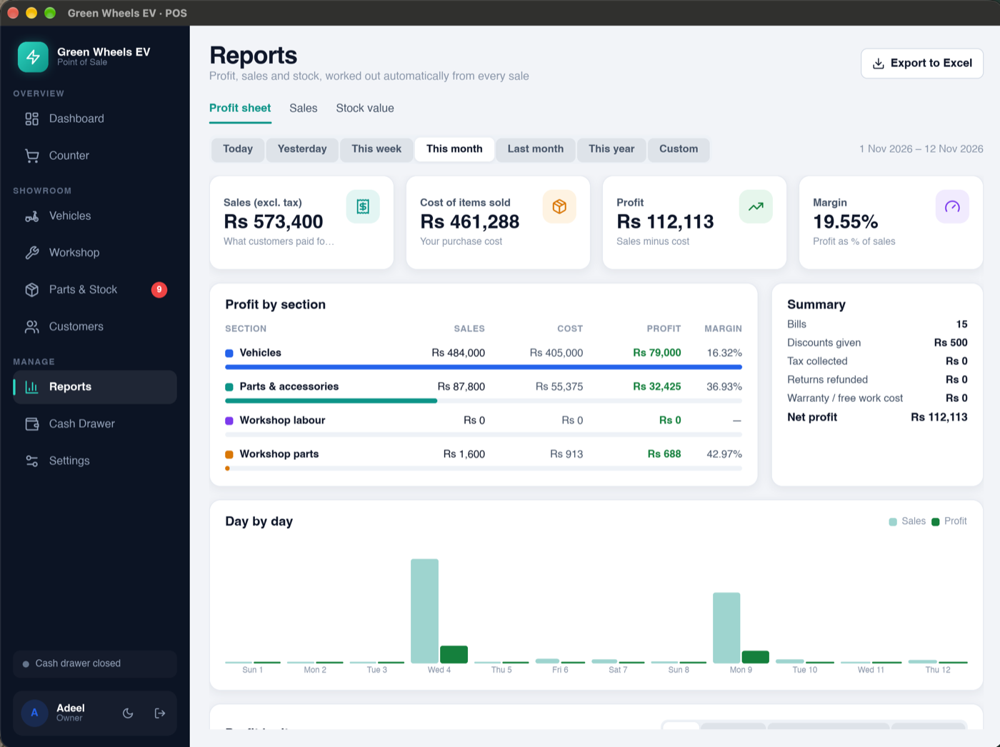
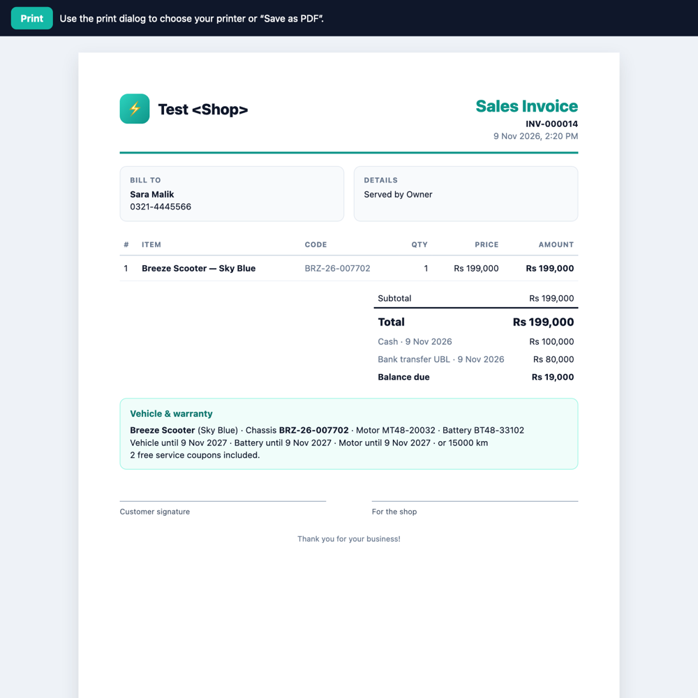

# EV Showroom POS

A fast point-of-sale app for an **electric-vehicle showroom**: sell bikes, run the workshop and sell spare parts, all in one place. It runs on **Windows and Mac**, works **without internet**, and keeps all data on your own computer.

Written in Rust with a native interface (Slint) and a built-in database (SQLite), so it opens quickly and stays fast even with thousands of products and sales.



---

## Contents

1. [Install it (no programming needed)](#1-install-it-no-programming-needed)
2. [First run](#2-first-run)
3. [What it does](#3-what-it-does)
4. [Build it yourself from the code](#4-build-it-yourself-from-the-code)
5. [Your data and backups](#5-your-data-and-backups)
6. [Troubleshooting](#6-troubleshooting)
7. [For developers](#7-for-developers)

---

## 1. Install it (no programming needed)

Download the file for your computer from the [**Releases**](https://github.com/rafaykhokhar/POS/releases) page. Until a release is published, the latest builds are on the [**Actions**](https://github.com/rafaykhokhar/POS/actions) page: open the newest green run and scroll to **Artifacts**.

### Windows

1. Download **`EV-Showroom-POS-windows.exe`**.
2. Make a folder for it, for example `C:\EV Showroom POS\`, and move the file there.
3. Double-click it.
4. If Windows shows **"Windows protected your PC"**, click **More info → Run anyway**. This appears because the app isn't signed with a paid certificate; it only happens the first time.
5. To get a desktop icon: right-click the file → **Send to → Desktop (create shortcut)**.

### Mac

1. Download **`EV-Showroom-POS-<version>-mac.dmg`**. It works on both Apple Silicon (M1/M2/M3/M4) and Intel Macs.
2. Open it and drag **EV Showroom POS** into the **Applications** folder.
3. Open it from Applications. The first time, macOS will say it **can't verify the app**:
   - Click **Done** (or **OK**).
   - Open **System Settings → Privacy & Security**, scroll down, and click **Open Anyway** next to "EV Showroom POS was blocked".
   - Confirm with your password. After this it opens normally.

> Prefer Terminal? This does the same in one step:
> ```bash
> xattr -dr com.apple.quarantine "/Applications/EV Showroom POS.app"
> ```

---

## 2. First run

The first time it opens, a short setup appears:

1. **Shop details:** name, phone and address (printed on receipts and invoices).
2. **Money & tax:** your currency symbol (Rs, $, AED…), and your tax rate (use 0 if you don't charge tax).
3. **Owner account:** your name and a **PIN** (4–8 digits) to log in.
4. Leave **"Fill with sample data"** on if you want to look around with example bikes, parts, customers and workshop jobs first.

Then add your staff in **Settings → Staff & PINs**. Each person logs in with their own PIN and only sees what their role allows:

| Role | Can use |
| --- | --- |
| Owner | Everything, including settings and staff |
| Manager | Everything except settings and staff |
| Salesperson | Counter, bike sales and bookings, customers |
| Service Advisor | Workshop, counter, customers |
| Technician | Workshop only (doesn't need a PIN) |
| Cashier | Counter, customers, cash drawer |

**Starting fresh after trying the sample data:** close the app and delete the data file (see [Your data and backups](#5-your-data-and-backups)). Setup will appear again.

---

## 3. What it does

| Screen | What you can do |
| --- | --- |
| **Dashboard** | Today's sales and profit, last 7 days chart, low stock, workshop status, services due, recent sales |
| **Counter** | Type a product code and press **Enter** (`2*BRK-001` adds two), or search by name. Discounts per item or on the whole bill, hold a bill and serve the next customer, pay by cash, bank transfer or both, with change worked out. Shortcuts: **F2** search, **↑ ↓** pick, **F8** hold, **F12** pay |
| **Vehicles** | Every bike tracked by **chassis, motor and battery number**. Statuses: in stock, booked, demo, in transit, sold. Selling a bike registers its **vehicle, battery and motor warranty** and **free service coupons** automatically. Bookings with advance payments |
| **Workshop** | Job-card board: Received → Diagnosing → Waiting for parts → In progress → Ready. Parts come out of stock as they're added. Warranty jobs and free-service jobs cost the customer nothing. Deliver & bill, with the next service date set automatically |
| **Parts & Stock** | Your own product codes (the app can suggest one). Items **turn red** when stock reaches the level you set, and **amber** when getting close. Stock adjustments with reasons, stock counts, receiving stock from suppliers (average cost updates itself), full history per item |
| **Customers** | Each customer's bikes, purchases, workshop visits and payments. See who owes money and take payments |
| **Reports** | **Profit sheet worked out automatically** from cost and sale prices, split into vehicles, parts and workshop and shown per item, with a daily chart. Sales list with full bill details and **returns/refunds**. Stock value. **Export to Excel** |
| **Cash Drawer** | Open the day with the cash in the drawer, record cash in and out, count and close: it shows if anything is short or extra |
| **Settings** | Shop details, currency and tax, staff and PINs, workshop service prices, backups, activity log |
| **Printing** | Receipts (80 mm thermal printers), A4 invoices with the bike's chassis and warranty details, and workshop job cards. They open in the normal print dialog, so any printer works, or you can save as PDF |

| | |
| --- | --- |
|  |  |
|  |  |
|  |  |



---

## 4. Build it yourself from the code

You only need this if you want to change the app or make your own installer.

### Prerequisites

Install these once:

| What | Mac | Windows |
| --- | --- | --- |
| **Build tools** | Open Terminal and run `xcode-select --install` (this also installs Git) | Install [Visual Studio Build Tools](https://visualstudio.microsoft.com/visual-cpp-build-tools/) and tick **"Desktop development with C++"**. The Rust installer below offers to do this for you. |
| **Git** | Included with the build tools above | Install [Git for Windows](https://git-scm.com/download/win) |
| **Rust** | `curl --proto '=https' --tlsv1.2 -sSf https://sh.rustup.rs \| sh` then restart Terminal | Download and run **rustup-init.exe** from [rustup.rs](https://rustup.rs), choose the default option, then restart the terminal |

Check everything is ready (all three should print a version number):

```bash
git --version
rustc --version
cargo --version
```

### Get the code and run it

```bash
git clone https://github.com/rafaykhokhar/POS.git
cd POS
cargo run --release -p pos-app
```

The first build downloads its libraries and takes a few minutes. After that it starts in seconds.

### Make an app you can install or share

**Mac** (creates a universal app for Apple Silicon + Intel, installs it in Applications, and makes a `.dmg` to share):

```bash
rustup target add aarch64-apple-darwin x86_64-apple-darwin
scripts/package-macos.sh --install
```

The DMG is saved in the `dist` folder.

**Windows:**

```powershell
cargo build --release -p pos-app
```

The app is `target\release\ev-pos.exe`. Copy it anywhere and double-click it. It's a single file with nothing else to install.

### Automatic builds on GitHub

Every push to `main` runs [`.github/workflows/build.yml`](.github/workflows/build.yml) on real Windows and Mac machines:

- runs all tests;
- builds the Windows `.exe` and the Mac `.dmg` (download them under **Artifacts**);
- **launches the app on Windows** and saves screenshots (artifact `windows-screenshots`), failing if the app crashes.

To publish a release with both downloads, push a version tag:

```bash
git tag v0.1.0
git push origin v0.1.0
```

---

## 5. Your data and backups

Everything is stored in one file:

| | Location |
| --- | --- |
| **Windows** | `%APPDATA%\EV Showroom POS\pos.db` (paste this into the File Explorer address bar) |
| **Mac** | `~/Library/Application Support/EV Showroom POS/pos.db` |

- **Automatic backups:** every day when the app closes, a copy goes into the `backups` folder next to it. The newest 30 are kept.
- **Back up now:** **Settings → Backup & data → Back up now** saves a copy anywhere, for example a USB drive.
- **Restore a backup:** close the app, then replace `pos.db` with the backup file (rename it to `pos.db`).
- **New computer:** install the app, then copy `pos.db` into the location above before opening it.

---

## 6. Troubleshooting

| Problem | Fix |
| --- | --- |
| **Mac:** "can't be opened" or "Apple could not verify" | See [Install → Mac](#mac), step 3 |
| **Windows:** "Windows protected your PC" | Click **More info → Run anyway** |
| **Windows:** the window is blank or flickers on an old PC | Open Command Prompt, run `setx SLINT_BACKEND winit-software`, then reopen the app. This uses software drawing instead of the graphics card |
| Forgot a staff member's PIN | An owner can set a new one in **Settings → Staff & PINs** |
| **Building on Windows:** `linker 'link.exe' not found` | Install Visual Studio Build Tools with **Desktop development with C++**, then open a new terminal |
| **Building on Mac:** `xcrun: error: invalid active developer path` | Run `xcode-select --install` |

---

## 7. For developers

```
crates/pos-core    Business logic and database. No UI. All rules, money maths, permissions and reports.
crates/pos-app     The desktop app: Slint screens (ui/) and the Rust code that connects them (src/screens/).
packaging/         App icon, Mac Info.plist, Windows icon.
scripts/           package-macos.sh builds the Mac app and DMG.
```

- **Tests:** `cargo test --workspace`. They cover sales, discounts, tax (included or added), average cost, stock levels, returns, vehicle sales with warranty and coupons, bookings, the workshop flow, permissions, the cash drawer and printing.
- **Money** is stored as whole minor units (no floating point), so totals and profit never drift.
- **Developer shortcuts** (debug builds only, never in release builds):
  - `EV_POS_DATA_DIR=/some/folder` uses a separate data folder.
  - `EV_POS_DEV_DEMO=1` creates a sample shop and logs in.
  - `EV_POS_DEV_PAGE=counter|vehicles|workshop|products|customers|reports|cash|settings` opens a page.

  ```bash
  EV_POS_DATA_DIR=/tmp/evpos-demo EV_POS_DEV_DEMO=1 cargo run -p pos-app
  ```

The interface uses [Slint](https://slint.dev) under its royalty-free desktop licence, which asks for the "Made with Slint" credit shown in **Settings → About**.
